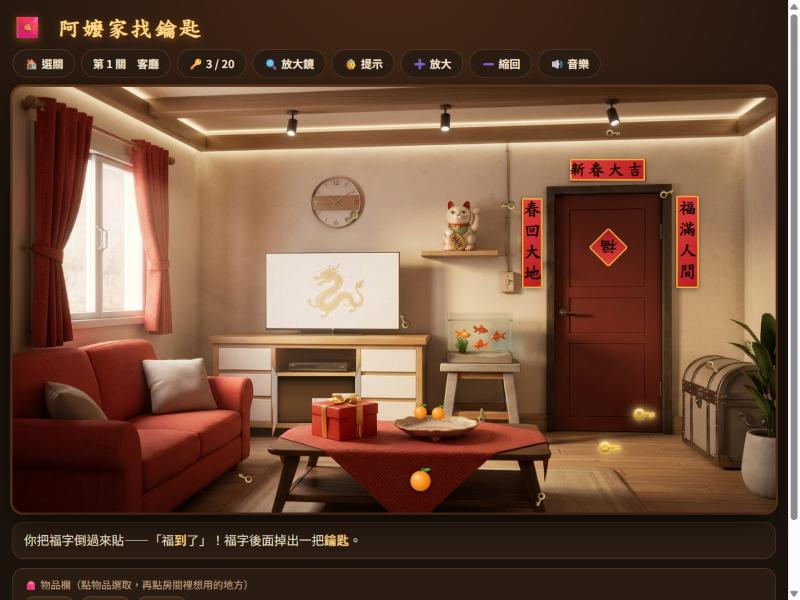
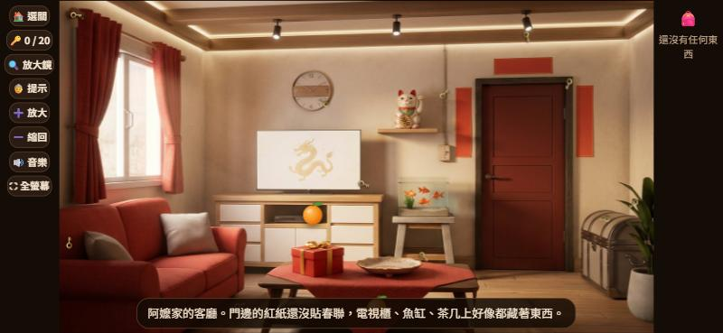

# 🧧 阿嬤家找鑰匙

過年回阿嬤家，阿嬤說：「家裡藏了 **100 把鑰匙**，全部找到，就開飯、發大紅包！」

一款以台灣過年為主題的點擊解謎遊戲。在 5 個場景裡找出藏起來的鑰匙、用道具解開機關，最後回家和阿公阿嬤一起吃年夜飯。



### 🎮 線上試玩：https://suwen3337.github.io/ama-house-keys/

## 怎麼玩

- 點房間裡的東西探索；撿到的道具會放進物品欄
- 點物品欄的道具選取它，房間裡可以用的地方會發光，再點那裡就能使用
- 每個場景 20 把鑰匙：約 12 把藏在角落要用眼睛找，8 把要解機關才會出現
- 找到 15 把鑰匙，門或樓梯就會帶你到下一個地方
- 卡關時可以用 🔍 **放大鏡**（讓一把藏起來的鑰匙閃一下）或 👵 **阿嬤提示**
- 進度會自動存在瀏覽器裡

| 關卡 | 場景 | 機關舉例 |
|---|---|---|
| 1 | 客廳 | 春聯貼到門邊、福字倒過來貼、關燈找夜光密碼 |
| 2 | 廚房 | 年糕放進蒸籠、倒貓罐頭給橘貓、照月曆的圈圈開碗櫥 |
| 3 | 阿嬤的房間 | 點油燈讓牆上浮現密碼、撕月曆、搬板凳拿衣櫃頂的箱子 |
| 4 | 頂樓陽台 | 阿公的紙條是倉庫密碼、撒飼料讓鴿子飛回來、澆菜 |
| 5 | 廟口夜市 | 叫醒橘貓、投銅板許願、用竹竿撥下樹上的燈籠 |

### 手機也能玩

手機橫放會切換成手機版：左邊按鈕、右邊物品欄，可以兩指放大、單指拖曳找角落的鑰匙。



## 執行方式

不需要安裝任何東西，直接用瀏覽器打開 `index.html`（入口頁）或 `阿嬤家/index.html`（直接進遊戲）就能玩。

## 技術重點

純 HTML／CSS／JavaScript，沒有使用任何外部函式庫或框架。

- **資料驅動的關卡設計**：所有關卡、可點區域、機關、提示都寫在 `LEVELS` 資料裡，加一關只需要一張圖和一段設定，不用改遊戲引擎。網址加上 `?edit` 會進入標記模式，在圖上拖曳就能得到座標。
- **從背景圖切塊做動畫**：門、抽屜、蓋子是把背景圖的那一塊切下來，用 CSS 3D 轉動或滑動；被擋住的前景（例如禮盒、蕨類）另外疊回最上層。動畫使用 Web Animations API。
- **圖片處理**：拿起東西後原位要變空，所以用 `tools/clean-images.ps1`（PowerShell 內嵌 C#）把物品從圖上擦掉（用周圍顏色擴散補圖），再比對原圖與補好的圖做出去背圖。
- **即時合成的音樂**：背景音樂與音效都是用 Web Audio API 即時合成，旋律用簡譜寫在程式裡（五聲音階，搭配鼓、木魚、鑼、鈸、嗩吶音色），不需要任何音樂檔。
- **手機支援**：依螢幕形狀切換版面，自己實作兩指縮放與拖曳（Pointer Events），並放大觸控範圍。

## 專案結構

```
index.html            入口頁（列出所有遊戲）
阿嬤家/
  index.html          遊戲本體（關卡資料、引擎、音樂都在這個檔案）
  images/             場景圖、照片、結局圖，以及處理過的圖
tools/
  clean-images.ps1    擦掉物品、製作去背圖的腳本
docs/                 README 用的截圖
阿嬤家-場景圖提示詞.md  產生場景圖用的提示詞
bento-shop.html       練習作品：便當店經營小遊戲
new-year-keys.html    練習作品：「阿嬤家找鑰匙」最早的單一房間版本
```

## 素材來源

| 素材 | 來源 |
|---|---|
| 遊戲設計、劇情、程式 | 原創 |
| 場景圖、照片、結局圖 | 使用 AI 圖片生成工具產生，提示詞記錄在 `阿嬤家-場景圖提示詞.md` |
| 補圖與去背 | 用 `tools/clean-images.ps1` 從上述圖片處理而成 |
| 道具、動物等小插圖 | 用 SVG 程式繪製 |
| 背景音樂與音效 | 原創旋律，用 Web Audio API 即時合成，未使用任何現成歌曲或錄音 |
| 字型 | 使用裝置內建字型 |

開發過程使用 AI（Claude）協助。

本作品為非營利的個人練習作品，圖中人物皆為 AI 生成，不代表真實人物。

## 授權

程式碼以 [MIT License](LICENSE) 授權。場景圖片與照片僅供本作品展示使用。
